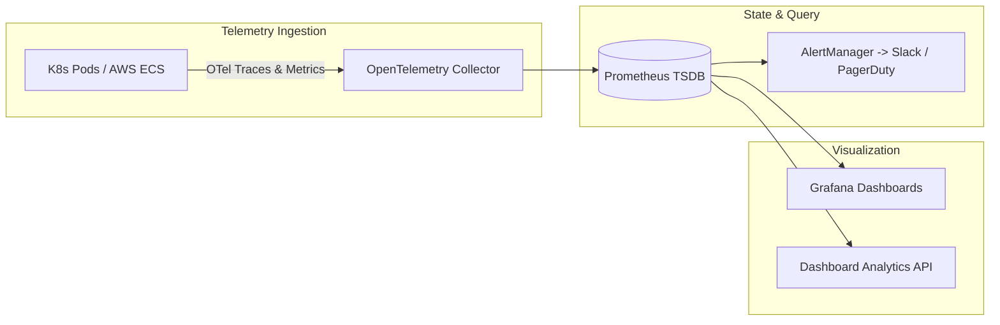

# Infra Monitoring Dashboard

[](https://github.com/donny-devops/infra-monitoring-dashboard/actions)
[](LICENSE)

> Real-time infrastructure observability stack integrating Prometheus, OpenTelemetry, Grafana, and automated alert routing.

## Architecture



## Quickstart

```bash
git clone https://github.com/donny-devops/infra-monitoring-dashboard.git
cd infra-monitoring-dashboard
docker compose up -d
```

- Grafana: http://localhost:3000 (admin / admin)
- Prometheus: http://localhost:9090

## Overview

A ready-to-run observability foundation for engineers and DevOps teams. It surfaces CPU, memory, disk, network, service health, and alerts in one place and can be extended with additional exporters or data sources.

## Features

- Prometheus + Alertmanager + Grafana stack via Docker Compose
- OpenTelemetry-friendly ingestion path
- Pre-configured dashboards and alert routing examples
- Easy local or VPS deployment

## Tech Stack

- Prometheus
- Grafana
- Alertmanager
- OpenTelemetry Collector
- Docker Compose
- Optional Node Exporter / cAdvisor

## License

MIT. See [LICENSE](LICENSE).
